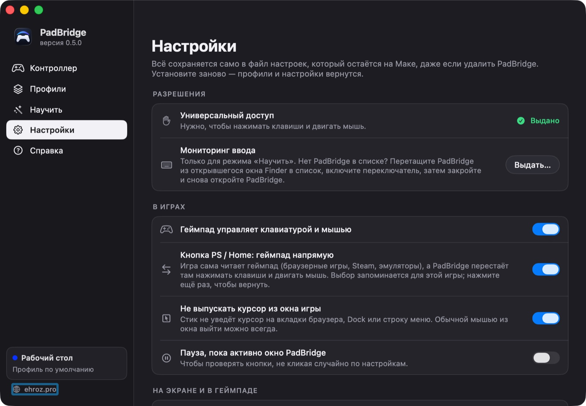

<h1 align="center">PadBridge</h1>

Геймпад в любой игре на Mac — не только в Steam. DualShock 4, DualSense, Xbox и Switch Pro там, где игра сама их не понимает.

  <a href="https://github.com/ehroz1/padbridge-releases/releases/latest"><b>⬇︎ Скачать последнюю версию</b></a>
  &nbsp;·&nbsp;
  <a href="https://ehroz.pro"><b>ehroz.pro</b></a>

## Что умеет

- **Любые игры**: браузерные, itch.io и GOG, Windows-игры в CrossOver / Whisky / Parallels, эмуляторы.
  Кнопки становятся клавишами, кликами и прокруткой, стик — плавным курсором.
- **Профили сами**: PadBridge видит, какая игра на переднем плане (даже `.exe` внутри Wine или вкладку
  браузера), и включает её раскладку. Для новой игры предложит раскладку по жанру.
- **Мышь не мешает игре**: курсор не уходит из окна игры, а кнопка <kbd>PS</kbd> выключает эмуляцию там,
  где игра сама понимает геймпад.
- **Режим «Диван»** (<kbd>L3</kbd> + <kbd>R3</kbd>): весь Мак с геймпада, с экранной клавиатурой.
- **Подсказка поверх игры** (<kbd>Share</kbd> + <kbd>Options</kbd>), слои, радиальное меню, гироскоп,
  тачпад, цвет световой панели.

## Установка

1. Скачайте `PadBridge-<версия>.dmg` из [последнего релиза](https://github.com/ehroz1/padbridge-releases/releases/latest).
2. Откройте образ и перетащите **PadBridge** в «Программы».
3. Первый запуск: правый щелчок по PadBridge → «Открыть» → «Открыть».
   Если macOS всё равно не пускает: «Системные настройки → Конфиденциальность и безопасность → Всё равно открыть»
   или в Терминале `xattr -dr com.apple.quarantine /Applications/PadBridge.app`.
4. Знакомство проведёт по шагам: разрешение, геймпад, главные кнопки.

Работает на macOS 13 и новее.

## Обновления

PadBridge обновляется сам: раз в полчаса проверяет этот репозиторий, скачивает новую версию,
проверяет её (SHA-256 и подпись) и ставит, когда геймпад не трогали 3 минуты, — игра не прервётся.
Вручную: «Справка → Обновить сейчас» или пункт в меню значка.

Настройки и профили хранятся в `~/Library/Application Support/PadBridge` и не пропадают,
даже если удалить приложение.

---

Здесь только готовые сборки. Сделано <a href="https://ehroz.pro">ehroz.pro</a>

